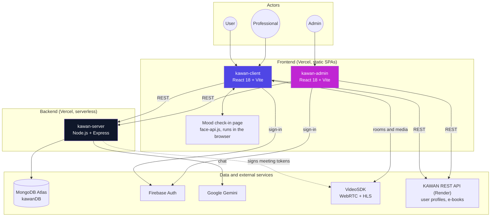
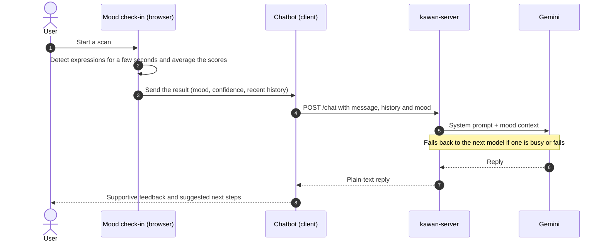
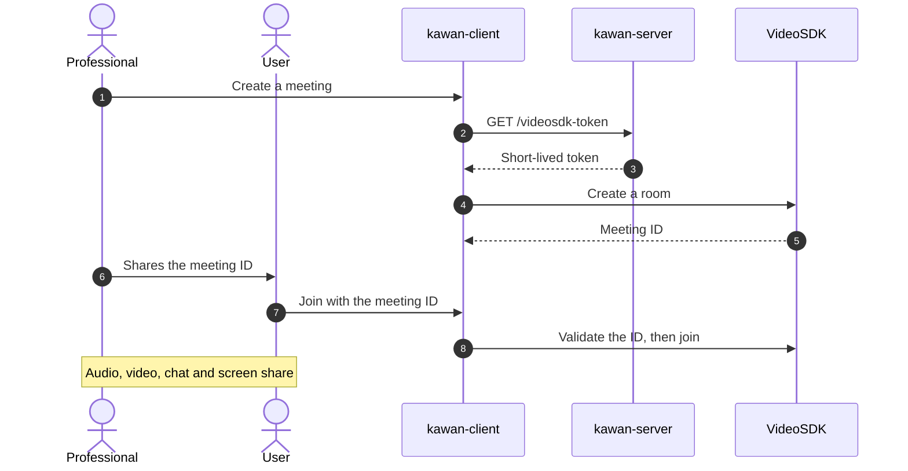
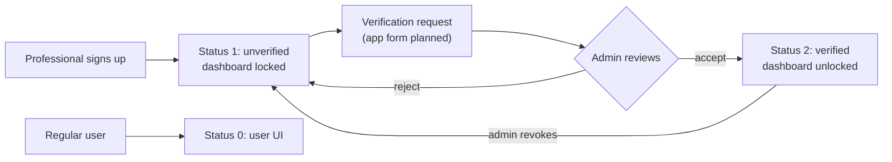
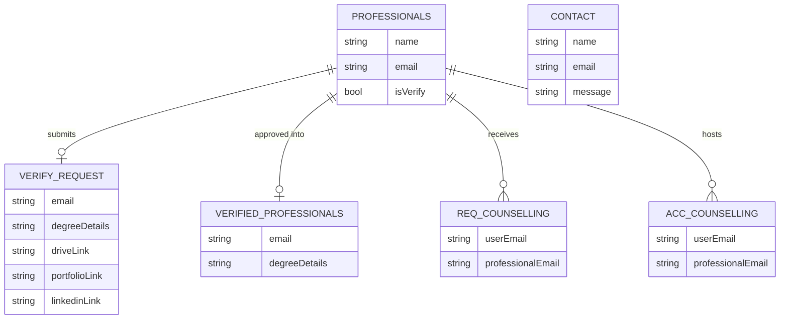
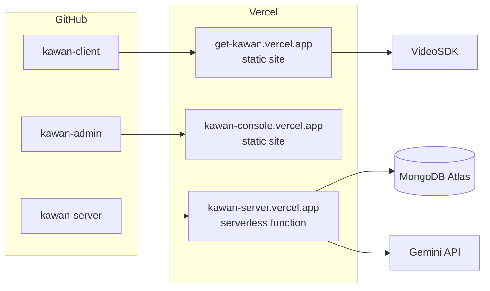

<div align="center">

# KAWAN

**A mental health and self-development web platform: an AI companion, on-device mood check-ins, live video counselling with verified professionals, e-books, meditation and stress-relief games.**

*"Kawan" means "friend" in Malay. The goal is a supportive friend on the way to better mental health.*

[](https://get-kawan.vercel.app)
[](https://kawan-console.vercel.app)
[](https://kawan-server.vercel.app)
[](LICENSE)


</div>

---

## Table of Contents

- [Overview](#overview)
- [Live Demo](#live-demo)
- [Screenshots](#screenshots)
- [Features](#features)
- [Repository Structure](#repository-structure)
- [Architecture](#architecture)
- [How It Works](#how-it-works)
- [Data Model](#data-model)
- [Tech Stack](#tech-stack)
- [Getting Started](#getting-started)
- [Working with Submodules](#working-with-submodules)
- [Deployment](#deployment)
- [Project Documents](#project-documents)
- [Known Limitations and Roadmap](#known-limitations-and-roadmap)
- [Research and Inspiration](#research-and-inspiration)
- [License](#license)
- [Team](#team)

---

## Overview

Mental health support is often expensive, hard to find, or stigmatised. KAWAN brings several kinds of help into one place:

- **An AI companion** that listens, replies in the user's own language and gives practical, evidence-informed suggestions.
- **Self-awareness tools**, such as a camera mood check-in that runs entirely in the browser, so no image ever leaves the device.
- **Self-development content**: e-books with audio chapters, guided meditation and small stress-relief games.
- **Real people when it matters**: live video sessions with mental health professionals, who must be verified by an admin first.

The platform has three applications. This repository is the **umbrella repo**: it links the three as git submodules and holds the project documentation (SRS, flow diagrams, benchmark analysis, survey results and scope of work).

---

## Live Demo

| App | For | URL |
|---|---|---|
| Client | Users and professionals | https://get-kawan.vercel.app |
| Admin console | Administrators | https://kawan-console.vercel.app |
| API | Both frontends | https://kawan-server.vercel.app |

To look around without registering, click **Continue as Guest (Demo)** on the login page of the client or the admin console.

---

## Screenshots

| Home | AI chatbot |
|---|---|
|  |  |
| **E-books** | **Admin dashboard** |
|  |  |
| **Meditation** | **Kawan Puzzle** |
|  |  |
| **Tic-Tac-Toe** | **15 Puzzle** |
|  |  |

---

## Features

| Area | Feature | Status |
|---|---|---|
| Emotional support | AI chatbot (Google Gemini) with conversation history, quick replies and crisis-aware answers | Live |
| | Mood check-in: face expression detection with face-api.js, averaged over a short scan, can be shared with the chatbot | Live |
| Professional help | Professional sign-up and role detection (user, unverified, verified) | Live |
| | Live video sessions (VideoSDK): create or join a meeting, chat, screen share, raise hand, viewer mode | Live |
| | Professionals submit verification documents from the app | Planned |
| | Users book a session from the app | Planned |
| Self-development | E-book library, reader and audio chapters | Live |
| | Guided meditation timer | Live |
| | Games: Tic-Tac-Toe, 15 Puzzle, Kawan Puzzle | Live |
| Administration | Verify or revoke professionals | Live |
| | Browse users, read and delete contact messages | Live |
| Accounts | Email/password and Google sign-in (Firebase), password reset, guest demo login | Live |

---

## Repository Structure

```
kawan/
├── client/        submodule: kawan-client  (React app for users and professionals)
├── admin/         submodule: kawan-admin   (React admin console)
├── server/        submodule: kawan-server  (Node.js + Express REST API)
├── docs/          project documentation
│   ├── srs-document/         Software Requirements Specification (PDF)
│   ├── FigJam-Files/         SRS diagram and stakeholder flow diagram
│   ├── Benchmark-Analysis/   competitor and feature benchmark
│   ├── Work/                 project brief and scope of work
│   ├── survey/               user survey responses
│   ├── notion/               Notion workspace export
│   └── README.md             research notes and sources
├── .gitmodules
├── LICENSE
└── README.md
```

| App | Folder | Repository | Details |
|---|---|---|---|
| Client | `client/` | [kawan-client](https://github.com/mahfuzhasanreza/kawan-client) | [client/README.md](https://github.com/mahfuzhasanreza/kawan-client/blob/main/README.md) |
| Admin console | `admin/` | [kawan-admin](https://github.com/mahfuzhasanreza/kawan-admin) | [admin/README.md](https://github.com/mahfuzhasanreza/kawan-admin/blob/main/README.md) |
| API server | `server/` | [kawan-server](https://github.com/mahfuzhasanreza/kawan-server) | [server/README.md](https://github.com/mahfuzhasanreza/kawan-server/blob/main/README.md), [API reference](https://github.com/mahfuzhasanreza/kawan-server/blob/main/docs/API.md), [database](https://github.com/mahfuzhasanreza/kawan-server/blob/main/docs/DATABASE.md) |

---

## Architecture



**Key design decisions**

| Decision | Why |
|---|---|
| Separate apps for users, admins and the API | Each can be built, deployed and secured on its own |
| Secrets only on the server | The Gemini key and the VideoSDK secret never reach the browser. The client gets chat replies and short-lived (2-hour) meeting tokens instead. |
| Mood detection in the browser | Privacy: camera frames are analysed locally and never uploaded |
| Managed services | Firebase for identity, VideoSDK instead of running WebRTC/TURN servers, MongoDB Atlas for storage |
| Serverless-friendly API | The Express app is exported for Vercel and connects to MongoDB in the background, so cold starts stay fast |
| Graceful failure | Gemini model fallback list, request timeouts, meeting IDs validated before joining, clear error messages |
| CORS allow-list | The API only accepts requests from the configured frontend domains |

---

## How It Works

### AI companion with a mood check-in



### Live counselling session



### Professional verification and roles



After every login, both frontends call `GET /professionals/:email` to decide which interface to show.

---

## Data Model

The API stores its data in one MongoDB database, `kawanDB`. Collections are linked by email address.



User profiles and the e-book catalogue come from a separate KAWAN REST API hosted on Render. Every field and collection, including the unused and legacy ones, is documented in [server/docs/DATABASE.md](https://github.com/mahfuzhasanreza/kawan-server/blob/main/docs/DATABASE.md).

---

## Tech Stack

| Layer | Technologies |
|---|---|
| Frontend | React 18, Vite 5, React Router 6, Tailwind CSS, DaisyUI, Flowbite, TanStack Query, Axios, Lottie |
| Real-time and AI | VideoSDK React SDK, hls.js, face-api.js, Google Gemini API |
| Backend | Node.js, Express 4, jsonwebtoken, cookie-parser, cors, dotenv |
| Data and auth | MongoDB Atlas, Firebase Authentication |
| Hosting and tooling | Vercel, Firebase Hosting, ESLint, git submodules |

---

## Getting Started

### Prerequisites

- Node.js 18 or newer, and npm
- A MongoDB Atlas cluster (or any MongoDB connection string)
- A Firebase project with Email/Password and Google sign-in enabled
- A Google Gemini API key ([Google AI Studio](https://aistudio.google.com/app/apikey))
- A VideoSDK API key and secret ([VideoSDK dashboard](https://app.videosdk.live/api-keys))

### 1. Clone with submodules

```bash
git clone --recurse-submodules https://github.com/mahfuzhasanreza/kawan.git
cd kawan
```

If you already cloned without `--recurse-submodules`:

```bash
git submodule update --init --recursive
```

### 2. Add environment variables

| App | File | Variables |
|---|---|---|
| Server | `server/.env` | [server README](https://github.com/mahfuzhasanreza/kawan-server/blob/main/README.md#environment-variables) |
| Client | `client/.env.local` | [client README](https://github.com/mahfuzhasanreza/kawan-client/blob/main/README.md#environment-variables) |
| Admin | `admin/.env.local` | [admin README](https://github.com/mahfuzhasanreza/kawan-admin/blob/main/README.md#environment-variables) |

For local development, set `VITE_SERVER_URL=http://localhost:5000` in both frontends.

### 3. Install and run

Use three terminals:

```bash
# API, http://localhost:5000
cd server && npm install && npm start

# Client, http://localhost:5173
cd client && npm install && npm run dev

# Admin console, http://localhost:5174 (Vite picks the next free port)
cd admin && npm install && npm run dev
```

The server already allows requests from ports 5173 and 5174.

---

## Working with Submodules

Each app lives in its own repository. This repo stores a pointer to one commit of each app, so after pushing changes to an app you need to update the pointer here.

```bash
# Move every submodule to the latest commit on its main branch
git submodule update --remote --merge
git add client admin server
git commit -m "chore: update submodules"
git push
```

To work on an app from inside this repo:

```bash
cd client
git checkout main
git pull
# edit, commit and push in the client repo as usual
cd ..
git add client
git commit -m "chore: update client"
```

---

## Deployment



All three apps are deployed to Vercel. An older build of the client is also on Firebase Hosting at [kawan-assist.web.app](https://kawan-assist.web.app).

| Variable | Set on | Purpose |
|---|---|---|
| `VITE_SERVER_URL` | client, admin | API base URL. Built into the bundle, so redeploy after changing it. |
| `VITE_apiKey` to `VITE_appId` | client, admin | Firebase web config |
| `MONGODB_URI` | server | Database connection |
| `ACCESS_TOKEN_SECRET` | server | Signs the cookie JWT |
| `GEMINI_API_KEY`, `GEMINI_MODEL` | server | AI chatbot |
| `VIDEOSDK_API_KEY`, `VIDEOSDK_SECRET` | server | Signs meeting tokens |
| `CORS_ORIGINS` | server | Frontend domains allowed to call the API |

---

## Project Documents

| Document | File |
|---|---|
| Software Requirements Specification | [docs/srs-document/KAWAN-SRS-DOCUMENT.pdf](docs/srs-document/KAWAN-SRS-DOCUMENT.pdf) |
| SRS diagram | [docs/FigJam-Files/KAWAN-SRS.pdf](docs/FigJam-Files/KAWAN-SRS.pdf) |
| Stakeholder flow diagram | [docs/FigJam-Files](docs/FigJam-Files) |
| Benchmark analysis | [docs/Benchmark-Analysis](docs/Benchmark-Analysis) |
| Project brief | [docs/Work/PROJECT-BRIEF.pdf](docs/Work/PROJECT-BRIEF.pdf) |
| Scope of work | [docs/Work](docs/Work) |
| User survey results | [docs/survey/KAWAN-Survey-Form.csv](docs/survey/KAWAN-Survey-Form.csv) |
| Notion workspace export | [docs/notion/Project_KAWAN.pdf](docs/notion/Project_KAWAN.pdf) |
| Research notes | [docs/README.md](docs/README.md) |

---

## Known Limitations and Roadmap

KAWAN is a student project and is still in progress.

**Known limitations**

- **Admin access is not restricted.** Any signed-in account, including the guest demo, can open the admin console, and the API's admin endpoints do not check the caller's role.
- **No automated tests** in any of the three apps.
- **Two backends.** User profiles and e-books come from a separate API on Render's free tier, which can take up to a minute to respond after being idle.

**Roadmap**

- [ ] Admin roles: an allow-list or Firebase custom claims, checked by both the admin console and the API
- [ ] In-app verification form for professionals
- [ ] In-app booking of counselling sessions
- [ ] Automated tests for the API and the main user flows
- [ ] Move user profiles and e-books into `kawan-server`

Each app's README lists its own limitations in more detail.

---

## Research and Inspiration

- [Project documentation (Google Doc)](https://docs.google.com/document/d/1efYIouuSu-NFTUAaR8w5SeCy-2HHNsbSxx5I9jdeMXM/edit)
- [Project presentation (Canva)](https://www.canva.com/design/DAGWKiV0J78/nWWlxqMM3Rpj1XL5BVXLTw/view)
- [Benchmark analysis spreadsheet](https://docs.google.com/spreadsheets/d/1J8AfPHKpRivEmRA8HrWjgVThQq_iZle0VnUAQVUYDiA/edit)
- [Product comparison document](https://docs.google.com/document/d/1GWm28NUs-kjv6xZWh4-cn44rdl-gNbe276NblYnAyFo/edit)
- [User survey form](https://docs.google.com/forms/d/1cq6acIrDxcUTPaq9_EK4uwCKQak_V_30N5rYirtoms8)

KAWAN was inspired by [Headspace](https://www.headspace.com/), [Calm](https://www.calm.com/), [Woebot Health](https://woebothealth.com/), [BetterHelp](https://www.betterhelp.com/), [BetterUp](https://www.betterup.com/) and [LIMITLESS](https://www.limitless.sg/).

---

## License

Released under the [MIT License](LICENSE). Each app repository includes its own copy.

---

## Team

Built by **Team Daimyoz**. Developed and maintained by **[Mahfuz Hasan Reza](https://github.com/mahfuzhasanreza)**.
