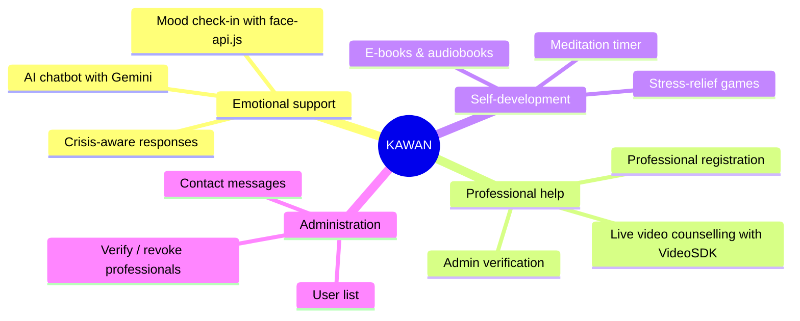
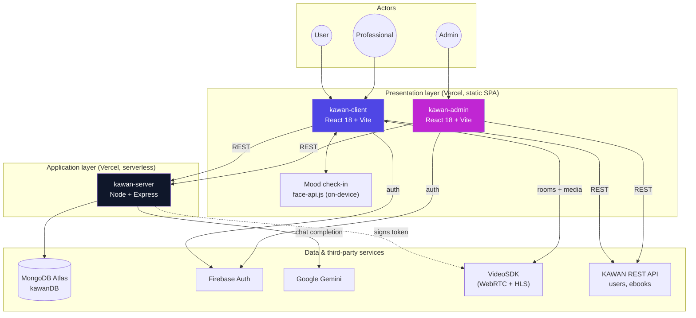
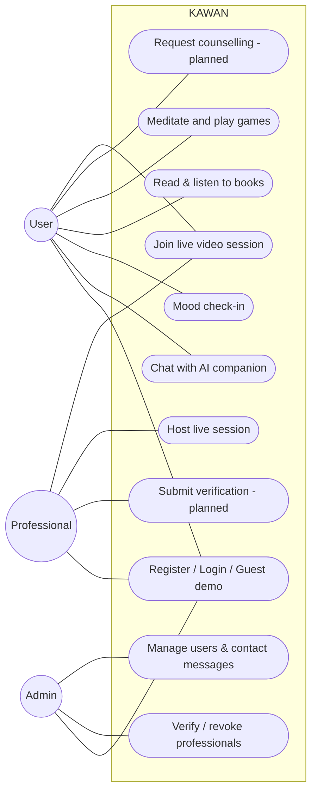
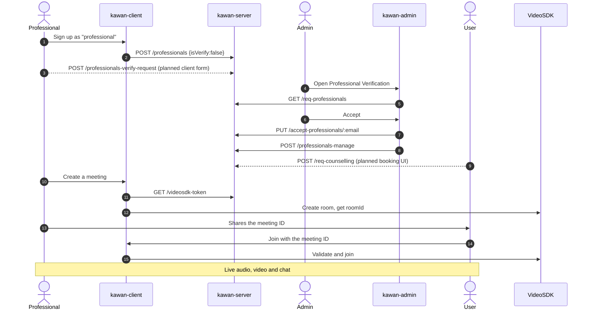
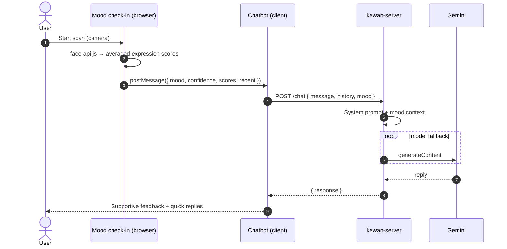
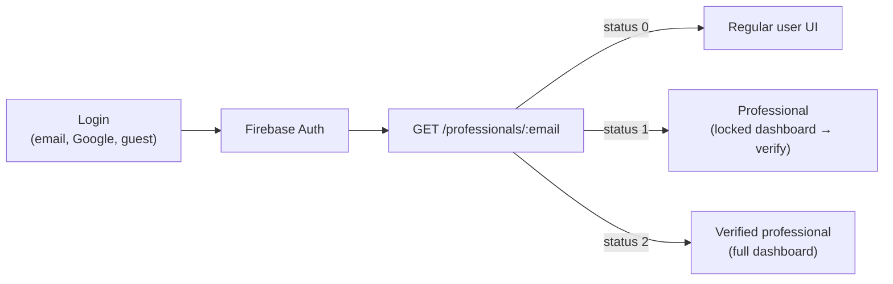
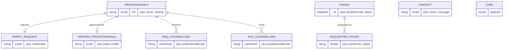
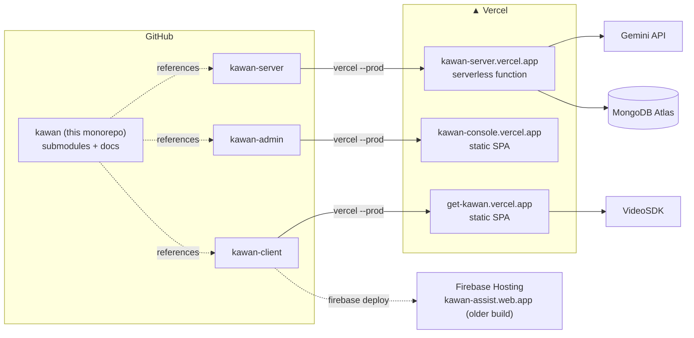
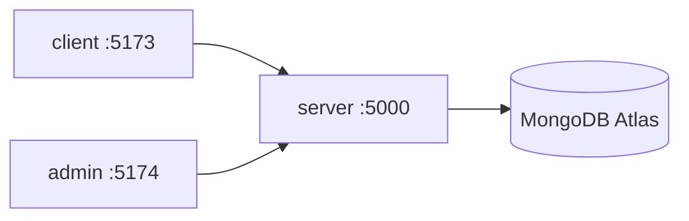
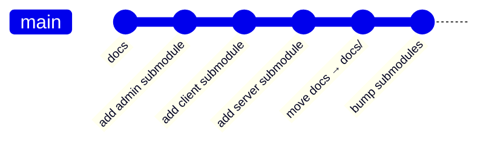

<div align="center">

# KAWAN: Your Mental Health Companion

**A full-stack mental health and self-development platform: AI companion, mood check-ins, live counselling with verified professionals, e-books, meditation and games.**

*"Kawan" means **friend** in Malay. The project is meant to be a supportive friend on the way to better mental health.*

[](https://get-kawan.vercel.app)
[](https://kawan-console.vercel.app)
[](https://kawan-server.vercel.app)


</div>

---

## Table of Contents

- [About](#about)
- [Screenshots](#screenshots)
- [Repository Layout](#repository-layout)
- [Feature Overview](#feature-overview)
- [System Architecture](#system-architecture)
- [Stakeholders & Use Cases](#stakeholders--use-cases)
- [Core Flows](#core-flows)
- [Data Model](#data-model)
- [Deployment Architecture](#deployment-architecture)
- [Tech Stack](#tech-stack)
- [Getting Started](#getting-started)
- [Working with Submodules](#working-with-submodules)
- [Documentation](#documentation)
- [Known Limitations](#known-limitations)
- [Research & Resources](#research--resources)
- [License](#license)
- [Team](#team)

---

## About

KAWAN goes beyond simple chat. It combines **personalised AI support**, **self-awareness tools**, **lifestyle guidance** and **access to real, verified professionals** in one place:

- **Personalised advice**: an empathetic AI companion that adapts to the user's mood and language.
- **Self-reflection**: camera mood check-ins processed entirely on the device.
- **Soft-skill and lifestyle development**: books, audiobooks, meditation and games.
- **Professional help when it matters**: live video counselling with professionals verified by KAWAN admins.

This repository is the **umbrella monorepo**. It pulls the three applications in as **git submodules** and holds all project documentation (SRS, flow diagrams, benchmark analysis, survey, scope of work).

> **Quick demo:** open the [client](https://get-kawan.vercel.app) or the [admin console](https://kawan-console.vercel.app) and click **Continue as Guest (Demo)** on the login page.

---

## Screenshots

| Home | AI chatbot |
|---|---|
|  |  |
| **Meditation** | **Admin dashboard** |
|  |  |

---

## Repository Layout

```
kawan/
├── client/   →  submodule: kawan-client   (React, users and professionals)
├── admin/    →  submodule: kawan-admin    (React, admin console)
├── server/   →  submodule: kawan-server   (Node/Express, REST API)
├── docs/                                    Project documentation
│   ├── srs-document/        KAWAN-SRS-DOCUMENT.pdf
│   ├── FigJam-Files/        SRS + stakeholder flow diagrams (.jam / .pdf)
│   ├── Benchmark-Analysis/  Competitor & feature benchmark (.xlsx / .docx)
│   ├── Work/                Project brief, scope of work
│   ├── survey/              User survey responses (.csv)
│   ├── notion/              Notion project workspace export
│   └── README.md            Research overview & sources of inspiration
├── .gitmodules
├── LICENSE                  MIT
└── README.md                ← you are here
```

| App | Folder | Repository | Live | README |
|---|---|---|---|---|
| Client | [`client/`](client) | [kawan-client](https://github.com/mahfuzhasanreza/kawan-client) | [get-kawan.vercel.app](https://get-kawan.vercel.app) | [client/README.md](client/README.md) |
| Admin | [`admin/`](admin) | [kawan-admin](https://github.com/mahfuzhasanreza/kawan-admin) | [kawan-console.vercel.app](https://kawan-console.vercel.app) | [admin/README.md](admin/README.md) |
| Server | [`server/`](server) | [kawan-server](https://github.com/mahfuzhasanreza/kawan-server) | [kawan-server.vercel.app](https://kawan-server.vercel.app) | [server/README.md](server/README.md) |

---

## Feature Overview



---

## System Architecture

### High-level view



### Architectural principles

| Principle | How it is applied |
|---|---|
| **Separation of concerns** | Separate deployables for users (client), operators (admin) and logic and data (server) |
| **Secrets stay on the server** | The Gemini key and VideoSDK secret live only in server env vars. The browser receives short-lived tokens and replies, never keys. |
| **Privacy by design** | Face expression analysis runs entirely in the browser; no image is uploaded |
| **Managed services over custom infra** | Firebase Auth for identity, VideoSDK instead of a self-hosted WebRTC/TURN stack, MongoDB Atlas for storage |
| **Serverless-ready** | The Express `app` is exported for `@vercel/node`. The DB connects in the background so cold starts stay fast. |
| **Resilience** | Gemini model fallback list, client timeouts and friendly error messages, validation of meeting IDs before joining |
| **Locked-down CORS** | The server only accepts the configured frontend origins (`CORS_ORIGINS`) |

---

## Stakeholders & Use Cases



The full stakeholder-wise flow is in [`docs/FigJam-Files/KAWAN Flow Diagram (Stake Holder Wise).pdf`](docs/FigJam-Files).

---

## Core Flows

### 1. Professional onboarding and live counselling

Solid arrows show what works today. Dashed arrows are steps whose server endpoints exist but have no UI yet.



### 2. AI companion with mood context



### 3. Authentication & roles



---

## Data Model

**`kawanDB`** (MongoDB Atlas, owned by `kawan-server`):



User profiles and the e-book catalogue are stored by the separate KAWAN REST API (`kawan.onrender.com/api/v1`). Field-level details are in [server/docs/DATABASE.md](server/docs/DATABASE.md), and every endpoint is in [server/docs/API.md](server/docs/API.md).

---

## Deployment Architecture



| Env var | Lives on | Purpose |
|---|---|---|
| `VITE_SERVER_URL` | client, admin | API base URL (**baked in at build time**, so redeploy after changing it) |
| `VITE_apiKey` … `VITE_appId` | client, admin | Firebase web config |
| `MONGODB_URI` / `DB_USER` + `DB_PASS` | server | Database |
| `ACCESS_TOKEN_SECRET` | server | Cookie JWT |
| `GEMINI_API_KEY`, `GEMINI_MODEL` | server | AI chatbot |
| `VIDEOSDK_API_KEY`, `VIDEOSDK_SECRET` | server | Signing meeting tokens |
| `CORS_ORIGINS` | server | Allowed frontend origins |

---

## Tech Stack

| Layer | Technologies |
|---|---|
| **Frontend** | React 18, Vite 5, React Router v6, Tailwind CSS + DaisyUI, Flowbite, Material Tailwind, TanStack Query, Axios, Motion / AOS / Lottie |
| **Real-time & AI** | VideoSDK React SDK, hls.js, face-api.js, Google Gemini |
| **Backend** | Node.js, Express 4, jsonwebtoken, cookie-parser, cors, dotenv |
| **Data & auth** | MongoDB Atlas, Firebase Authentication |
| **DevOps** | Vercel (CLI), Firebase Hosting, ESLint, git submodules |

---

## Getting Started

### 1. Clone with submodules

```bash
git clone --recurse-submodules https://github.com/mahfuzhasanreza/kawan.git
cd kawan

# already cloned without submodules?
git submodule update --init --recursive
```

### 2. Configure environment

| App | File | Template |
|---|---|---|
| server | `server/.env` | [server/README.md → Environment Variables](server/README.md#environment-variables) |
| client | `client/.env.local` | [client/README.md → Environment Variables](client/README.md#environment-variables) |
| admin | `admin/.env.local` | [admin/README.md → Environment Variables](admin/README.md#environment-variables) |

For local development set `VITE_SERVER_URL=http://localhost:5000` in both frontends.

### 3. Run everything (three terminals)

```bash
# Terminal 1: API
cd server && npm install && npm start          # http://localhost:5000

# Terminal 2: user app
cd client && npm install && npm run dev        # http://localhost:5173

# Terminal 3: admin console
cd admin && npm install && npm run dev         # http://localhost:5174
```



---

## Working with Submodules

Each app is its own repository. This monorepo records which **commit** of each app it points to.

```bash
# Pull the latest commit of every app
git submodule update --remote --merge
git add client admin server
git commit -m "chore: bump submodules"

# Work inside an app (commit and push there first)
cd client
git checkout main && git pull
# …edit, commit, push…
cd ..
git add client && git commit -m "chore: bump client"
```



---

## Documentation

| Document | Location |
|---|---|
| Software Requirements Specification | [`docs/srs-document/KAWAN-SRS-DOCUMENT.pdf`](docs/srs-document/KAWAN-SRS-DOCUMENT.pdf) |
| SRS diagram (FigJam) | [`docs/FigJam-Files/KAWAN-SRS.pdf`](docs/FigJam-Files/KAWAN-SRS.pdf) |
| Stakeholder-wise flow diagram | [`docs/FigJam-Files/KAWAN Flow Diagram (Stake Holder Wise).pdf`](docs/FigJam-Files) |
| Benchmark analysis | [`docs/Benchmark-Analysis/Project KAWAN Benchmark Analysis.xlsx`](docs/Benchmark-Analysis) |
| Project brief | [`docs/Work/PROJECT-BRIEF.pdf`](docs/Work/PROJECT-BRIEF.pdf) |
| Scope of work | [`docs/Work/KAWAN SCOPE OF WORK.xlsx`](docs/Work) |
| User survey results | [`docs/survey/KAWAN-Survey-Form.csv`](docs/survey/KAWAN-Survey-Form.csv) |
| Notion workspace | [`docs/notion/Project_KAWAN.pdf`](docs/notion/Project_KAWAN.pdf) |
| Research overview | [`docs/README.md`](docs/README.md) |

---

## Known Limitations

KAWAN is a student project and still in progress. The main gaps are:

- **Admin access isn't restricted.** Any logged-in account, including the public guest account, can open the admin console, and the server's admin endpoints don't check who is calling.
- **Two flows have server support but no UI yet:** professionals submitting a verification request, and users booking a counselling session.
- **No automated tests** in any of the apps.
- **Two backends.** Some data lives in a separate API on Render (`kawan.onrender.com`), which can be slow after it has been idle.

Each app's README lists its own limitations in more detail.

---

## Research & Resources

- **[Project Documentation (Google Doc)](https://docs.google.com/document/d/1efYIouuSu-NFTUAaR8w5SeCy-2HHNsbSxx5I9jdeMXM/edit)**
- **[Project Presentation (Canva)](https://www.canva.com/design/DAGWKiV0J78/nWWlxqMM3Rpj1XL5BVXLTw/view)**
- [Benchmark Analysis Spreadsheet](https://docs.google.com/spreadsheets/d/1J8AfPHKpRivEmRA8HrWjgVThQq_iZle0VnUAQVUYDiA/edit)
- [Product Comparison Document](https://docs.google.com/document/d/1GWm28NUs-kjv6xZWh4-cn44rdl-gNbe276NblYnAyFo/edit)
- [User Survey Form](https://docs.google.com/forms/d/1cq6acIrDxcUTPaq9_EK4uwCKQak_V_30N5rYirtoms8)

**Inspired by:** [Headspace](https://www.headspace.com/), [Calm](https://www.calm.com/), [Woebot Health](https://woebothealth.com/), [BetterHelp](https://www.betterhelp.com/), [BetterUp](https://www.betterup.com/), [LIMITLESS](https://www.limitless.sg/)

---

## License

Released under the [MIT License](LICENSE). Each app repository has its own copy.

---

## Team

**Team Daimyoz**, built and maintained by **[Mahfuz Hasan Reza](https://github.com/mahfuzhasanreza)**

<div align="center">
<sub>KAWAN aims to make mental health support accessible and approachable for everyone.</sub>
</div>
